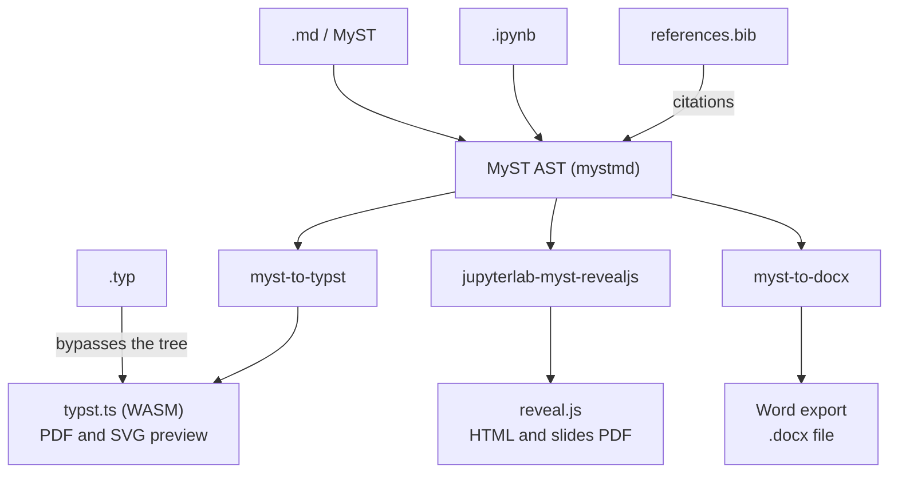

# Bargueño — App Spec

*As of 18 October 2026 · Dani Arribas-Bel*

## Overview

Bargueño is an offline-first writing studio for manuscripts and slide decks. It runs entirely in the browser as a PWA on iPad and desktop. Manuscripts are typeset with Typst and slides are rendered with reveal.js, all compiled locally through WebAssembly.

It is a heavily configured JupyterLab, delivered through JupyterLite, pared back into a minimal, writing-focused environment.

**Name.** A *bargueño* is the classic 16th-century Spanish portable writing cabinet. It is a chest of small drawers and compartments whose drop-front lid becomes the writing surface. The display name is **Bargueño**; the repo, package and URL slug is **`bargeno`**.

**Design principles**

- **Local first.** Nothing leaves the device unless the user exports it. There is no server, account or telemetry.
- **Constraint over options.** There are fewer panels, menus and settings than JupyterLab. Each feature has to earn its place.
- **One document model.** Every input format is parsed into the MyST AST, and every output is rendered from it.
- **Keyboard first.** Vim bindings are on by default, a hardware keyboard is assumed, and the command palette is the primary way to navigate.
- **Plain files.** Projects are ordinary folders of text files, so they round-trip cleanly through git (Working Copy on iPad).

## Scope

v1 targets iPad Safari (installed to the Home Screen) and desktop browsers. It is a PWA only, and a native wrapper is explicitly out of scope.

| Area | v1 | Later | Not planned |
| --- | --- | --- | --- |
| Platforms | iPad PWA, desktop browser PWA | Phone layout | Native iOS/macOS app |
| Inputs | .md, MyST, .ipynb, .typ | .qmd (subset, no execution) | Pandoc-wide format support |
| Outputs | PDF, Typst source, Word (.docx), standalone slide HTML, slides as PDF | EPUB | — |
| Files | In-app storage, zip import/export | Real local folders on desktop Chromium | Cloud sync service |
| Compute | Optional Pyodide, per project, off by default | Extra kernels | Server kernels |
| Collaboration | — | — | Real-time multi-user editing |

## Architecture

Bargueño is a heavily configured JupyterLab, delivered through JupyterLite as static files, with all compilation in WASM or JavaScript and no server. Keeping the stock JupyterLab shell preserves compatibility with jupyterlab-myst-revealjs, jupyterlab-vim and jupyterlab-myst. Every source except raw .typ is parsed into one MyST AST, and each output is a renderer over that tree.



*All of this runs in a JupyterLite shell: browser storage, service worker, vim, Harper and optional Pyodide.*

| Layer | Component | Source |
| --- | --- | --- |
| App shell | JupyterLab via JupyterLite, stripped down by disabled plugins, Simple Interface mode and `overrides.json` | JupyterLab; Bargueño config (new) |
| Look | Bargueño theme extension (light + dark) | Bargueño (new) |
| Bargueño plugins | Preview button, export commands, preferences, focus mode, .md slide adapter | Bargueño (new) |
| Parsing | mystmd parser and notebook loader | [mystmd](https://mystmd.org) |
| Rendering in the editor | jupyterlab-myst | Jupyter Book / MyST |
| Manuscripts | myst-to-typst + typst.ts | mystmd; typst.ts |
| Slides | jupyterlab-myst-revealjs + reveal.js | [PyPI](https://pypi.org/project/jupyterlab-myst-revealjs/) |
| Word | myst-to-docx | mystmd |
| Editor | CodeMirror 6 + jupyterlab-vim | JupyterLab ecosystem |
| Grammar | harper.js | Harper |
| Compute (optional) | Pyodide kernel | JupyterLite |
| Offline | Service worker + manifest | Bargueño (new) |

## Formats and document model

Every source except raw .typ is parsed into the MyST AST, which is the single internal representation for preview and export.

| Format | Role | Parsed by | Notes |
| --- | --- | --- | --- |
| .md / MyST | Manuscripts and decks | mystmd parser | Default authoring format; YAML frontmatter selects the output kind and template |
| .ipynb | Manuscripts and decks | mystmd notebook loader | Markdown cells use MyST; code cells show stored outputs unless compute is on |
| .typ | Manuscripts only | typst.ts directly | Bypasses the AST; full Typst, no Word export |
| .bib | References | Typst (manuscripts), citation-js (slides, Word) | One per project |

**Document kind.** The frontmatter key `bargeno.kind: manuscript | slides` decides the pipeline. If the key is missing, .typ files default to manuscript, and other files default to manuscript unless they contain slide breaks.

**Raw Typst inside MyST.** A ```` ```{raw} typst ```` block passes through to Typst output and is ignored by other outputs.

## Manuscripts

The pipeline is source → MyST AST → `myst-to-typst` → typst.ts (WASM) → SVG preview or PDF. Raw .typ files skip straight to typst.ts.

**Templates**

- Bundled templates live in the app: *article*, *report* and *letter*, with one shared house typographic style.
- User templates are .typ files in the project's `_templates/` folder, chosen in frontmatter (`template: _templates/thesis.typ`).
- A template receives the frontmatter (title, authors, affiliations, abstract, keywords, date) as Typst arguments. A documented contract makes writing a new template easy.

**Citations.** Each project has one `references.bib`. MyST `{cite}` roles map to Typst `@key` citations, and Typst's built-in bibliography handles BibTeX and CSL styles. The style is set in frontmatter, defaulting to APA.

**Fonts.** A small set of fonts is bundled and cached for offline use (one serif, one sans, one mono, plus a maths font). Users can add fonts to the project's `_fonts/` folder.

**Figures.** Images are imported into the project's `assets/` folder and referenced by relative path, with captions and cross-references through MyST figure directives.

## Slides

Preview and presenting reuse [jupyterlab-myst-revealjs](https://pypi.org/project/jupyterlab-myst-revealjs/), which renders a notebook as a reveal.js deck through jupyterlab-myst. Bargueño adds a .md adapter and its own export step.

**Slide breaks in .md, Quarto-style**

- `#` starts a section title slide, and `##` starts a new slide.
- `---` starts a new slide with no title.
- Fragments, speaker notes and slide-level options use MyST directives and attributes (for example `:::{notes}`).

**.md adapter.** At preview time, a .md deck is split into a virtual notebook of cells, with the `slide` and `subslide` metadata the extension expects. The source file is never rewritten.

**.ipynb decks** use the extension's cell metadata directly, plus Jupyter Book hide/remove tags and `gridwidth-*` columns.

**Theming.** There is one house reveal.js theme matching the app's look. A `slides.css` file in the project overrides it, consistent with the extension's `myst-revealjs.css` convention.

**Export.** Standalone HTML bundles reveal.js, the theme, fonts and assets into one self-contained file. Slides as PDF use reveal.js print mode rendered to PDF in the browser (to validate on iPad Safari, see Risks). This can reuse Slipway's export code.

## Editor and UI

The UI is stock JupyterLab, pared back and restyled rather than rebuilt. It keeps four regions: a collapsible file sidebar, an editor area with split panes, an on-demand preview pane, and a thin status bar.

**How it is stripped down**

- **Disabled plugins** (`disabledExtensions` in `jupyter-lite.json`): the launcher, the extension manager, the running-sessions panel, the settings editor UI, kernel and console menus, and most status bar items.
- **Simple Interface mode** by default, plus a hidden or minimal menu bar, with commands reached through the palette instead.
- **`overrides.json` defaults:** vim on, line numbers off, wrapped lines, theme following the system, and no autosave toasts.
- **Theme extension:** all styling lives in one Bargueño theme package, with versions pinned so internal class names stay stable.
- **Context menus** are pruned through JupyterLab's context-menu settings to writing-relevant entries.
- **Fallback:** if the chrome proves untameable, a custom shell built from `@jupyterlab/*` packages remains an option, at the cost of extension compatibility.

**Editor**

- CodeMirror 6 with vim bindings (via jupyterlab-vim), on by default.
- Notebooks open in a simplified cell view: no toolbar, minimal gutters, and Markdown cells edited as source.
- Syntax highlighting for MyST, Typst and BibTeX.

**Navigation**

- A collapsible sidebar with a project tree.
- A command palette (`Cmd/Ctrl-K`) for open file, switch project, export and run preview.
- An outline panel built from the document's headings, which can be toggled.

**Layout.** Multiple documents can be open in split panes, with each pane holding tabs. Preview is a pane too, opened with a button or command, and refreshed on demand rather than live.

**Look.** Light and dark themes follow the system setting. There is one typeface pairing, generous margins, no icons in the toolbar, and a status bar showing project, word count and vim mode.

**Preferences (one screen)**

- Vim mode on or off.
- On-screen keyboard mode: adds an accessory row with Esc, Ctrl, arrows and common Markdown keys, and enlarges touch targets.
- Theme override: system, light or dark.
- Spellcheck/grammar on or off, and the dictionary dialect (British English by default).

## Projects, storage and sync

A project is a folder, and it is the unit of import, export and settings.

```
my-paper/
├── bargeno.yml        # project settings: compute on/off, default template, citation style
├── paper.md
├── talk.ipynb
├── references.bib
├── slides.css         # optional slide overrides
├── assets/            # images and figures
├── _templates/        # optional user .typ templates
├── _fonts/            # optional extra fonts
└── _exports/          # generated outputs (git-ignorable)
```

**Storage.** Files live in JupyterLite's browser storage (IndexedDB). On first launch the app calls `navigator.storage.persist()`.

**Sync with Working Copy (iPad), manual zip round trip**

1. **Import:** pick a .zip of the repo folder from Files (exported from Working Copy). It unpacks into a new project, or replaces an existing one after confirmation.
2. **Export:** the project is zipped and handed to the share sheet, saved into Working Copy's folder in Files, unzipped there, and committed in Working Copy.
3. **Single-file import/export** is also possible, for quick edits.

Exports exclude `_exports/` by default and keep paths relative, so the zip mirrors the repo exactly.

**Future: desktop folders.** On Chromium desktop, the File System Access API could open a real local folder (a git checkout) as a project. A contents-manager adapter would read and write the folder directly, removing the zip step there. iPad behaviour stays the same.

## Computation

Compute is off by default and switched on per project with `compute: true` in `bargeno.yml`.

- When it is off, no kernel is loaded, code cells are read-only, and stored outputs render as-is in previews and exports.
- When it is on, a Pyodide kernel loads lazily the first time a cell runs, and a run button appears on code cells. Kernel files are cached for offline use only after the first opt-in, keeping the base install small.
- MyST `{eval}` roles and executable slides work only when compute is on.

## Writing aids

- **Spelling and grammar:** [Harper](https://writewithharper.com/) through its WASM build (harper.js), running fully offline. It lints prose only and skips code, maths, directives and Typst markup, with suggestions shown as underlines and fixes available from a vim-friendly popup.
- **Outline panel:** a heading tree for the active document, with click-to-jump, reflecting the slide structure for decks.
- **Focus mode:** hides the sidebar, status bar and other panes, centres the editor column, and optionally dims everything except the current paragraph.
- **Word count** sits in the status bar, for the whole document or the selection.

## Exports

All exports run on-device and are written to `_exports/`, then offered through the share sheet or a download.

| Output | From | Engine | Notes |
| --- | --- | --- | --- |
| PDF | Manuscripts (.md, .ipynb, .typ) | typst.ts | Primary output |
| Typst source (.typ) | Manuscripts from .md / .ipynb | myst-to-typst | Includes the template call; zipped with assets |
| Word (.docx) | Manuscripts from .md / .ipynb | myst-to-docx | Not from raw .typ; uses a house reference style |
| Standalone HTML | Decks | reveal.js bundler | Single self-contained file, works offline |
| Slides PDF | Decks | reveal.js print mode | One page per slide; fragments flattened |

## Hosting, build and distribution

Bargueño is open source in a public `bargeno` GitHub repo and served from GitHub Pages.

- **Build:** `jupyter lite build` with Bargueño's own extensions (shell, .md adapter, Typst preview, exporters, Harper), plus prebuilt jupyterlab-myst, jupyterlab-myst-revealjs and jupyterlab-vim. GitHub Actions builds and deploys on each tag.
- **PWA:** a manifest and an icon set, with a service worker that precaches the app shell, typst.ts WASM, fonts and reveal.js. Pyodide is cached on demand.
- **Updates:** a new service worker is installed in the background, and an "Update available, reload" notice appears in the status bar. User data is never touched by an update.
- **Licence:** BSD-3-Clause for code, matching Project Jupyter. CC-BY-4.0 covers bundled content: house templates, themes and the example project.

## Risks and open questions

**Risks**

| Risk | Impact | Mitigation |
| --- | --- | --- |
| Safari evicts browser storage | Lost work since last export | `storage.persist()`; frequent zip exports; Home Screen install (less eviction-prone) |
| JupyterLab chrome leaks through (dialogs, context menus, panels) | The app feels less minimal | Disable plugins aggressively; prune menus; theme every surface; custom shell as last resort |
| Theme CSS tied to JupyterLab internal classes | Breaks on upgrades | Pin JupyterLab version; keep all overrides in one theme package |
| First-load size (JupyterLab + typst.ts + fonts) | Slow first install on mobile data | Lazy-load Pyodide and exporters; subset fonts |
| jupyterlab-myst-revealjs is single-maintainer | Breakage on JupyterLab upgrades | Pin versions; be ready to fork |
| myst-to-typst / myst-to-docx coverage gaps | Missing features in PDF/Word | Define a supported MyST subset; raw Typst escape hatch |
| Slides-to-PDF in iPad Safari | Print mode may render poorly | Prototype early; fall back to rendering slides with Typst |
| Vim + iPad keyboard quirks (Esc, Cmd shortcuts) | Frustrating editing | Remappable Esc (Caps Lock / `jk`); test on hardware early |

**Open questions**

- [ ] Should document kind always be explicit in frontmatter? `---` is also a normal thematic break in manuscripts.
- [ ] Which house typefaces?
- [ ] Should Bargueño eventually absorb Slipway, or stay a sibling?
- [ ] Is a Typst-rendered slide fallback (for example Touying) worth offering for PDF decks?

## Milestones

1. **Spike:** a JupyterLite build with jupyterlab-myst, jupyterlab-myst-revealjs and jupyterlab-vim installed, opened on iPad offline. Confirm the slide extension works with no kernel.
2. **Typst preview:** a .md file with a MyST AST, rendered through myst-to-typst and typst.ts into an SVG preview pane; PDF export; bundled fonts.
3. **Projects and sync:** project folders, `bargeno.yml`, zip import/export via the share sheet, and a full round trip through Working Copy.
4. **Slides:** the .md-to-notebook adapter, the house theme, standalone HTML and PDF export.
5. **Strip and theme:** the disabled-plugin list, Simple Interface defaults, `overrides.json`, the Bargueño theme extension, pruned context menus, focus mode and the preferences screen.
6. **Polish:** templates (article, report, letter, plus the user template contract), citations, Word export, Harper, and optional Pyodide.
7. **v1 release:** a GitHub Pages deploy, documentation and an example project.
8. **Later:** desktop real-folder support, a .qmd subset and a phone layout.
