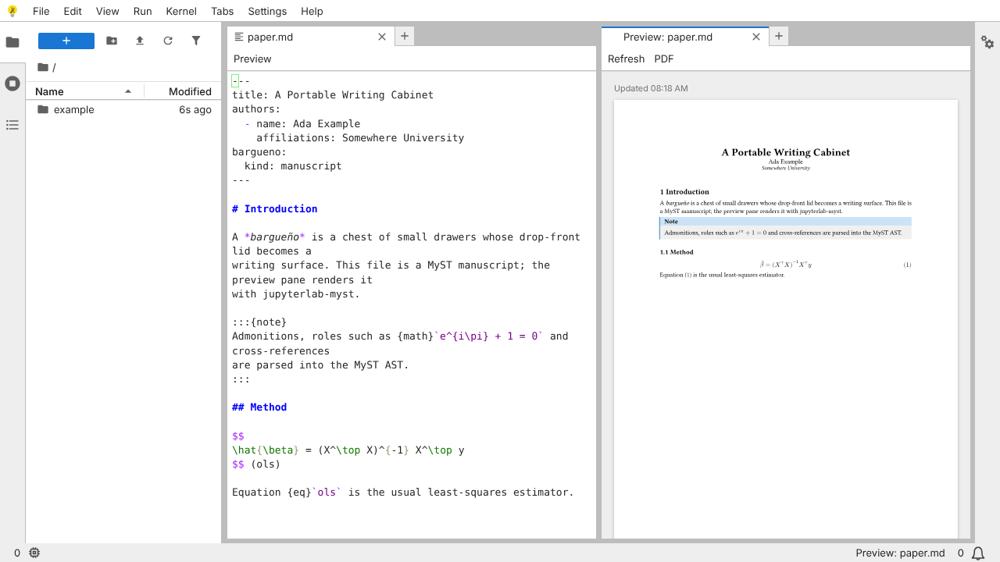

# Milestone 2 — Typst preview

**Goal (SPEC.md):** a .md file with a MyST AST, rendered through
myst-to-typst and typst.ts into an SVG preview pane; PDF export; bundled
fonts.



## What's new

The repo's first JupyterLab extension, `extension/` (npm package
`bargueno`), built with `jupyter labextension build` and picked up by
`jupyter lite build` through `federated_extensions`. It has two plugins:

| Plugin | Does |
| --- | --- |
| `bargueno:typst` | Preview pane, PDF and Typst-source exports, `.typ` file type, *Preview* button on editors |
| `bargueno:kernel-policy` | Opens notebooks without starting or asking for a kernel when none exists (fixes the spike's "Select Kernel" dialog) |

**Commands** (palette category *Bargueño*): *Preview Manuscript*, *Refresh
Preview*, *Export Manuscript as PDF*, *Export Manuscript as Typst Source*.

### Pipeline

```
.md  → myst-parser → myst-transforms (targets, maths, numbering, refs)
     → myst-to-typst → main.typ = #import template + macros + #show: article.with(frontmatter) + body
.typ → passed through untouched
main.typ + template + images → typst.ts web compiler (WASM) → vector → typst.ts renderer → SVG
                                                            → PDF
```

- `extension/src/myst.ts`: MyST → Typst, and frontmatter → template arguments.
- `extension/src/templates.ts`: the house *article* template and the
  template contract (title, subtitle, authors with affiliations, date,
  abstract, keywords, language; British English by default).
- `extension/src/engine.ts`: one lazily loaded typst.ts compiler and
  renderer, with calls queued because they share the virtual file system.
- `extension/src/preview.ts`: the preview widget and export helpers.

### Behaviour

- The preview opens split-right of the editor and typesets the **current
  editor text**, saved or not.
- It refreshes **on demand**: the *Refresh* button, the command, or saving
  the file (`:w` in vim). It never re-typesets on each keystroke.
- Typst errors and conversion warnings appear in red above the pages, and
  the last good pages stay visible.
- Images referenced with relative paths are read from the project and
  mapped into Typst's virtual file system.
- Exports go to `<document folder>/_exports/` and are also downloaded.
  The Typst export inlines the template, so it compiles on its own with the
  Typst CLI.

### Fonts and assets

Typst's own default fonts are bundled, so raw `.typ` files look the same as
with the Typst CLI: Libertinus Serif (regular, italic, bold, bold italic),
New Computer Modern Math and DejaVu Sans Mono (regular, bold). They come
from the pinned npm package `@typst-wasm/fonts` (OFL / GUST / Bitstream Vera
licences; see `bargueno/typst/FONTS-NOTICE.txt` in the build).
`scripts/postbuild.py` copies them and the two WASM modules into
`dist/bargueno/typst/`, where the service worker precaches them.

## Verified headlessly (`make test`, 11 tests)

- [x] `paper.md` previews as typeset pages: title block, numbered headings,
      the note admonition, and a numbered equation with a working reference.
- [x] The editor's *Preview* button opens the pane.
- [x] Saving the source re-typesets the preview.
- [x] Typst errors show up in the pane (for example `unknown variable`).
- [x] `sketch.typ` (raw Typst, with a table) previews and exports a PDF.
- [x] `paper.md` exports a PDF and a standalone `.typ`.
- [x] Preview works with the network off after one visit.
- [x] Notebooks and decks open with **no kernel dialog**.

## Findings

1. **Install size has doubled.** The precache is now about 61 MB (790
   files), and 28 MB of that is the typst.ts web compiler (10.8 MB
   gzipped). Options:
   - (a) Cache Typst on first preview instead of at install. That is
     smaller up front, but the preview won't work offline until it has
     been opened once online.
   - (b) Keep the current approach (fully offline after install) and tell
     the user how big the first install is.
   - (c) Look for a smaller compiler build.

   This needs a decision before v1.
2. **Tables from MyST need Typst packages.** myst-to-typst writes MyST
   tables with `@preview/tablex` and subfigures with `@preview/subpar`.
   Those packages are fetched from Typst Universe, which isn't reachable
   offline. Raw Typst `#table` works. Fix (milestone 6): bundle these two
   packages into the virtual file system through a typst.ts package
   registry, or override the table handler to emit native `#table`.
3. **typst.ts's `format` takes the numeric `CompileFormatEnum`**, not the
   string `'pdf'`; a string silently produces vector output.
4. **Only *article* is bundled.** `template:` values other than `article`
   fall back to it with a warning. *report*, *letter* and `_templates/`
   are milestone 6.
5. The kernel policy currently asks "do any kernels exist?". Once
   `bargueno.yml` is read (milestone 3), it should follow `compute:`
   instead.
