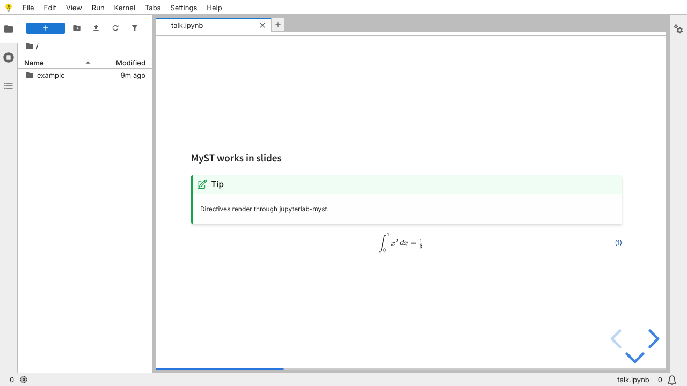

# Milestone 1 — Spike

**Goal (SPEC.md):** a JupyterLite build with jupyterlab-myst,
jupyterlab-myst-revealjs and jupyterlab-vim, opened on iPad offline; confirm
the slide extension works with no kernel.

## What is in the build

| Package | Version |
| --- | --- |
| jupyterlite-core (ships JupyterLab 4.6.4) | 0.8.6 |
| jupyterlab-myst | 2.7.0 |
| jupyterlab-myst-revealjs | 1.5.1 |
| jupyterlab-vim | 4.1.4 |

No kernel package is installed, so the app has zero kernel specs.

## Verified headlessly (`make test`, Chromium)

- [x] All three extensions activate inside JupyterLite.
- [x] `.md` opens in CodeMirror with vim bindings on (normal-mode `x` deletes).
- [x] `talk.ipynb` opens through `slideshow:open` as a live reveal.js deck:
      MyST admonitions, KaTeX maths, stored code outputs and arrow-key
      navigation all work with no kernel.
- [x] After one online visit, the app shell, the deck and the manuscript all
      open with the network switched off (the Bargueño service worker).

## Still to check by hand on iPad

- [ ] Open the Pages URL in Safari, *Add to Home Screen*, launch it once online.
- [ ] Turn on Airplane Mode, relaunch from the Home Screen, open
      `example/talk.ipynb` → *Open as Slideshow* and `example/paper.md`.
- [ ] Vim with a hardware keyboard: does Esc reach the editor? (Cmd-. and
      Caps Lock-as-Esc are the usual iPadOS workarounds.)
- [ ] Do edits survive closing and reopening the app?

## Findings

1. **"Select Kernel" dialog on every notebook.** The slideshow factory (like
   JupyterLab's own notebook factory) prefers a kernel, and JupyterLab prompts
   whenever no kernel spec matches. No setting turns this off. The deck renders
   behind the dialog and *No Kernel* dismisses it. **Fix:** the first Bargueño
   plugin should set `kernelPreference.shouldStart = false` on opened documents
   while `compute` is off.
2. **JupyterLite's service worker is not an offline cache.** It skips every
   `/api/*` path (contents listing, translations), so the app cannot boot
   offline with it. `lite/service-worker.js` replaces it: it precaches the app
   shell and keeps JupyterLite's `/api/drive` broadcast so a Pyodide kernel
   can still be added later.
3. **First-load size:** about 26.5 MB precached (752 files) out of a 32 MB
   build. The biggest pieces are JupyterLab core (2.8 MB), the reveal.js
   extension (2.3 MB, plus 0.6 MB) and jupyterlab-myst (1.3 MB). Disabling
   plugins (milestone 5) and lazy-loading exporters should bring this down.
4. **The first `##` heading in a slide doubles as a MyST title block**
   (hidden), which is harmless but worth knowing when theming slides.
5. **`window.jupyterapp`** is exposed (`exposeAppInBrowser`) for tests and
   debugging. Since nothing leaves the device this is harmless, but it can be
   dropped from production builds later.
6. The repo slug is `bargueno`, while SPEC.md says `bargeno`. The Pages URL
   will follow the repo name.

## Next: milestone 2 (Typst preview)

This needs the first real labextension in the repo (TypeScript, built with
`jupyter labextension build`). It should carry the kernel-preference fix
above and a preview pane: `.md` → mystmd → myst-to-typst → typst.ts → SVG.
